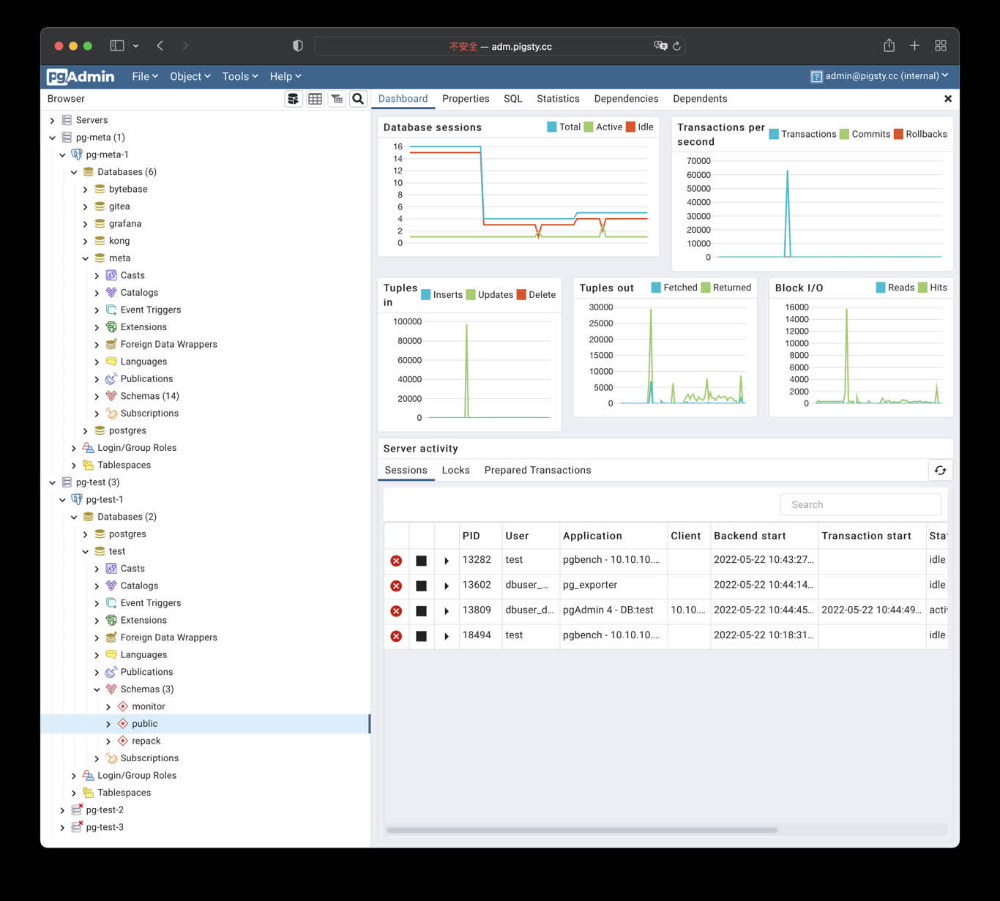

[pgAdmin](https://www.pgadmin.org/) is an open-source PostgreSQL administration and development GUI. Pigsty provides the `app/pgadmin` Docker Compose template. It can generate a server list and password file from the current inventory.

> [!WARNING] Change the defaults first
> The template login is `admin@pigsty.cc` with password `pigsty`. It is suitable only for a local demo. Before deployment on a shared network or the Internet, change the credentials, restrict port access, and configure HTTPS.

--------

## Quick Start

`conf/meta.yml` declares pgAdmin on the `app` group by default. Deploy it against an explicitly limited target:

```bash
./docker.yml -l app
./app.yml -l app -e app=pgadmin
```

The default port is `8885`; use `http://<app_ip>:8885`. `http://adm.pigsty` works only after `infra_portal`, Nginx, and DNS are configured.

The first container start can take tens of seconds. Check it on the application node:

```bash
cd /opt/pgadmin
make info
make log
```

--------

## Application Configuration

Override `.env` through `apps.pgadmin.conf` on the `app` group in `pigsty.yml`:

```yaml
all:
  children:
    app:
      hosts: { 10.10.10.10: {} }
      vars:
        docker_enabled: true
        app: pgadmin
        apps:
          pgadmin:
            conf:
              PGADMIN_DEFAULT_EMAIL: dba@example.com
              PGADMIN_DEFAULT_PASSWORD: <strong-random-password>
              PGADMIN_LISTEN_ADDRESS: 0.0.0.0
              PGADMIN_PORT: 8885
              PGADMIN_SERVER_JSON_FILE: /pgadmin4/servers.json
              PGADMIN_REPLACE_SERVERS_ON_STARTUP: 'False'
```

`app.yml` copies the template to `/opt/pgadmin` and writes overrides to `/opt/pgadmin/.env`. This file contains the login password and should remain mode `0600`.

`PGADMIN_DEFAULT_EMAIL` and `PGADMIN_DEFAULT_PASSWORD` are used only for initialization; they do not reset an existing account's password. The template mounts the server list at `/pgadmin4/servers.json` and the password file at `/pgadmin4/pgpass`. Changing environment variables does not change these mounts automatically.

The current template uses the unpinned `dpage/pgadmin4` image. For production, pin a tested version or digest in `docker-compose.yml` and validate image upgrades as separate changes.

--------

## Load the Server List

`env_pgadmin` generates:

- `/infra/pgadmin/servers.json`: PostgreSQL instance list
- `/infra/pgadmin/pgpass`: database administrator password file

In the default `conf/meta.yml`, the `infra` and `app` groups use the same host. pgAdmin can therefore mount both files directly. With separate pgAdmin and Infra hosts, `/infra/pgadmin/` is not automatically available on the application node. Securely distribute equivalent files or customize the mounts. A local path is not shared across hosts.

After rotating database credentials, first regenerate the Infra files:

```bash
./infra.yml -l infra -t env_pgadmin
```

Generated server definitions use `PassFile: "/.pgpass"`, which pgAdmin Server mode [resolves relative to the user's storage directory](https://www.pgadmin.org/docs/pgadmin4/latest/import_export_servers.html). `make pass` uses the container's current `PGADMIN_DEFAULT_EMAIL` (replacing `@` with `_`) to locate `/var/lib/pgadmin/storage/<email_dir>/.pgpass`, writes passwords from the latest host source file, and sets mode `0600`. The host requires `jq`.

The container's built-in password file initialization runs only when the configuration database is first created. Pigsty's `make up`, `make start`, and `make restart` automatically call `make pass` to refresh `.pgpass` without changing existing server definitions. After rotating database credentials, regenerate the Infra files and refresh passwords only:

```bash
./infra.yml -l infra -t env_pgadmin
./app.yml -l app -e app=pgadmin -t app_launch -e app_args=pass
```

Initial setup imports the server list automatically. The template defaults to `PGADMIN_REPLACE_SERVERS_ON_STARTUP=False` to retain servers added through the Web UI. `make list`, `make conf`, and `make reload` also use the current `PGADMIN_DEFAULT_EMAIL`. They add `--replace` to replace all of that user's server definitions only when `PGADMIN_REPLACE_SERVERS_ON_STARTUP` is exactly the capitalized string `'True'`. The upstream image does not recognize lowercase `true`; in `apps.pgadmin.conf`, use the quoted string `'True'`, not the YAML boolean `true`.

`pgpass` contains only the `pg_admin_username` / `pg_admin_password` used when generating the file, with wildcards for host, port, and database. Add appropriate entries when clusters use different administrator credentials. Restrict access to the files, backups, and application host. If pgAdmin should not hold DBA credentials, generate connection definitions for a dedicated least-privilege role instead.

--------

## Domain and HTTPS

Add an entry to [`infra_portal`](/docs/infra/param/#infra_portal):

```yaml
all:
  vars:
    infra_portal:
      pgadmin:
        domain: adm.pigsty
        endpoint: "10.10.10.10:8885"
```

Update Nginx on the explicitly limited Infra group:

```bash
./infra.yml -l infra -t nginx
```

For a real public domain, point DNS at the server and set `certbot` on the portal entry:

```yaml
infra_portal:
  pgadmin:
    domain: adm.example.com
    endpoint: "10.10.10.10:8885"
    certbot: adm.example.com
```

```bash
./infra.yml -l infra -t nginx_certbot,nginx_reload -e certbot_sign=true
```

See [CA and Certificates](/docs/infra/admin/cert/) for prerequisites and renewal. The directly exposed port `8885` is not an HTTPS endpoint.

--------

## State and Management

From `/opt/pgadmin`:

```bash
make up       # start the container and refresh .pgpass
make view     # show access endpoints
make log      # follow container logs
make info     # docker inspect
make list     # import servers for the current user; add --replace only when set exactly to True
make pass     # refresh only the current user's .pgpass
make conf     # run make list, then make pass
make stop     # stop the container
make restart  # restart the container and refresh .pgpass
```

Compose mounts the named volume `pgadmin-data` at `/var/lib/pgadmin` to retain the pgAdmin configuration database, user storage, and UI settings across container recreation. Back up this volume before cleanup or upgrades.



--------

## Security Checklist

- Change the default pgAdmin login and never distribute real credentials in scripts, screenshots, or tickets.
- The default port mapping listens on the host network; restrict sources with a firewall and use Nginx with valid HTTPS for Internet access.
- Protect `/infra/pgadmin/pgpass` and `/opt/pgadmin/.env`; prefer a least-privilege database role.
- Pin and validate the container image, and back up any pgAdmin state you choose to persist.
- pgAdmin can execute privileged SQL. Dropping a database, table, or data still requires separate target confirmation and a recent backup.
