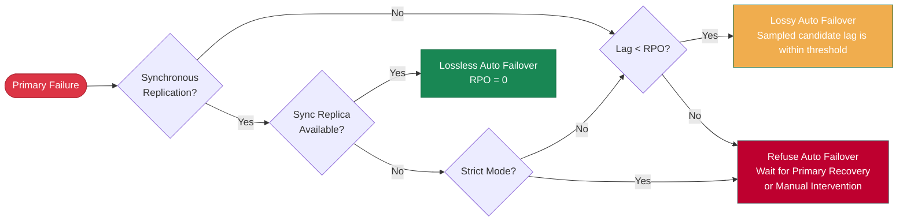

**RPO** (Recovery Point Objective) defines the **maximum amount of data loss** allowed when the primary fails.

Critical data, such as financial transactions, typically requires RPO = 0: no data loss.

Stricter RPO targets increase write latency and reduce throughput. Replica failure can also make the primary unavailable. Some workloads accept limited data loss for higher performance and availability.

--------

## Trade-offs

Asynchronous replicas normally lag behind the primary by about 10KB–100KB or 100µs–10ms, depending on network and throughput. At primary failure, a replica might not have received the latest data. Promotion can lose those unreplicated changes.

[**`pg_rpo`**](/docs/pgsql/param#pg_rpo) sets Patroni `maximum_lag_on_failover`. The default is `1048576` (1MiB). This is a **sampled candidate-lag threshold**. It does not set a hard bound on actual data loss.

After primary failure, Pigsty can promote a replica whose lag is within the threshold. If every replica exceeds it, Pigsty refuses [**automatic failover**] to avoid data loss. An operator must choose between waiting for primary recovery, which might never occur, and accepting loss through forced promotion.

Patroni does not sample primary WAL position continuously. Worst-case asynchronous loss can include WAL from the latest `ttl` window. On average, sampling adds roughly `loop_wait/2` of WAL. Account for write rate when setting the threshold. A higher threshold allows more candidates and increases the chance of automatic failover.

Set [**`pg_rpo`**](/docs/pgsql/param#pg_rpo) = 0 to enable **synchronous replication**. The primary acknowledges writes only after at least one replica persists them. This removes replication lag for acknowledged writes, but increases latency and reduces throughput.

-----------------

## Protection Modes

Pigsty offers three protection modes for different RPO requirements. They resemble [**Oracle Data Guard**](https://docs.oracle.com/en/database/oracle/oracle-database/21/sbydb/oracle-data-guard-protection-modes.html) protection modes.

> [!IMPORTANT] Maximum Performance
> - **Default asynchronous mode**: Commit after local WAL persistence without waiting for replicas. Replica failures do not affect the primary.
> - Primary failure can lose unsent or unreceived WAL. The 1MiB default sampled candidate threshold does not bound actual loss.
> - Use for performance-sensitive workloads that tolerate limited failure-related data loss.

> [!TIP] Maximum Availability
> - Set [**`pg_rpo = 0`**](/docs/pgsql/param#pg_rpo) to enable `synchronous_mode: true`.
> - Normally, wait for at least one replica acknowledgement to prevent data loss. If **all synchronous replicas fail**, automatically switch to asynchronous operation.
> - This balances data protection and availability. It is recommended for **critical production workloads**.

> [!NOTE] Maximum Protection
> - Use `crit.yml` to enable `synchronous_mode: true` and `synchronous_mode_strict: true`.
> - A transaction must persist on at least one replica before success. If all synchronous replicas fail, **the primary refuses writes**.
> - Use for financial transactions, medical records, and other workloads with very strict integrity requirements.

| **Name**                   |                     **Maximum Performance**                     |                         **Maximum Availability**                         |                    **Maximum Protection**                     |
|:---------------------------|:---------------------------------------------------------------:|:------------------------------------------------------------------------:|:-------------------------------------------------------------:|
| **Replication**            |                        **Asynchronous**                         |                             **Synchronous**                              |                    **Strict Synchronous**                     |
| **Data Loss**              | **Possible** (replication lag) | **Zero normally, minor when degraded** |          **Zero**           |
| **Write Latency**          |          **Lowest**           |      **Medium** (+1 network RTT)       | **Medium** (+1 network RTT) |
| **Throughput**             |          **Highest**          |              **Reduced**               |         **Reduced**         |
| **Replica Failure Impact** |           **None**            |  **Auto degrade, service continues**   |   **Primary stops writes**   |
| **RPO**                    | **Possible loss; 1MiB default candidate threshold** | **= 0 normally / possible loss after degradation** | **= 0** |
| **Use Case**               |               Typical business, performance first               |                     Critical business, safety first                      |               Financial core, compliance first                |
| **Configuration**          |                         Default config                          |              [**`pg_rpo`**](/docs/pgsql/param#pg_rpo) = `0`              |    [**`pg_conf`**](/docs/pgsql/param#pg_conf): `crit.yml`     |
{.full-width}

------

## Implementation

These modes use two **Patroni** parameters: [**`synchronous_mode`**](https://patroni.readthedocs.io/en/latest/replication_modes.html#synchronous-mode) and [**`synchronous_mode_strict`**](https://patroni.readthedocs.io/en/latest/replication_modes.html#synchronous-mode).

- **`synchronous_mode`** enables synchronous replication. When enabled, **`synchronous_mode_strict`** controls strict behavior.
- **`synchronous_mode_strict = false`** is the default. If replicas fail, allow asynchronous operation so the **primary continues service**: Maximum Availability.
- **`synchronous_mode_strict = true`** prevents asynchronous fallback. The **primary stops writes** until a synchronous replica recovers: Maximum Protection.

|         Mode         |            **`synchronous_mode`**            |        **`synchronous_mode_strict`**         | Replication Mode       | Replica Failure Behavior                                    |
|:--------------------:|:--------------------------------------------:|:--------------------------------------------:|------------------------|:------------------------------------------------------------|
| **Max Performance**  | **`false`** |                      -                       | **Async**              | **No impact**             |
| **Max Availability** | **`true`** | **`false`** | **Synchronous**        | **Auto degrade to async** |
|  **Max Protection**  | **`true`** | **`true`** | **Strict Synchronous** | **Primary refuses writes** |
{.full-width}

Set [**`pg_rpo`**](/docs/pgsql/param#pg_rpo) to `0` to enable `synchronous_mode` and **Maximum Availability**. Select [**`pg_conf`**](/docs/pgsql/param#pg_conf) = [**`crit.yml`**](/docs/pgsql/template/crit) to enable `synchronous_mode_strict` and **Maximum Protection**. You can also enable [**watchdog**](/docs/pgsql/param#patroni_watchdog_mode) to fence a frozen primary node or Patroni process instead of degrading. This provides behavior equivalent to Oracle Maximum Protection.

You can [**configure Patroni directly**](/docs/pgsql/admin/patroni#modify-config). Consult Patroni and PostgreSQL documentation for stronger protection options:

- Configure the [**synchronous replica list**](/docs/pgsql/config/cluster#quorum-commit). Add synchronous replicas for greater disaster tolerance, use quorum commit, or require acknowledgements from all replicas.
- [**Set**](/docs/pgsql/admin/patroni#modify-config) [**`synchronous_commit`**](https://www.postgresql.org/docs/current/runtime-config-wal.html#GUC-SYNCHRONOUS-COMMIT) to `'remote_apply'` for consistent primary/replica reads and writes. Oracle Maximum Protection corresponds to `remote_write`.

------

## Recommendations

**Maximum Performance** is the default asynchronous mode and suits most workloads. It accepts some failure-related loss for higher throughput and availability. [**`pg_rpo`**](/docs/pgsql/param#pg_rpo) sets sampled candidate lag. Actual worst-case loss also depends on write rate, `ttl`, and sampling time.

**Maximum Availability** suits high-integrity workloads. Acknowledged transactions are protected while a synchronous replica is healthy. If all synchronous replicas fail, the cluster can switch to asynchronous operation. At least two PostgreSQL nodes are required: one primary and one replica. Set [**`pg_rpo`**](/docs/pgsql/param#pg_rpo) to 0.

**Maximum Protection** suits financial transactions, medical records, and other workloads requiring strict integrity. Use at least three nodes: one primary and two replicas. With only two nodes, replica failure stops primary writes and reduces service availability. With three, the primary can continue after one replica fails.
