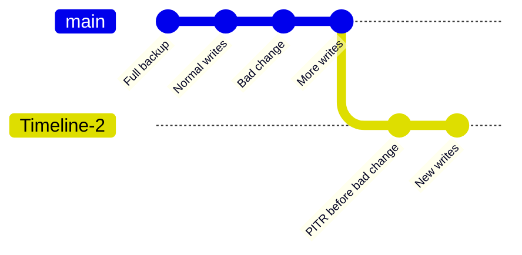

A database is a state machine. **WAL** (Write-Ahead Log) records its changes in order. PostgreSQL writes each change to WAL before applying it to data files. Keep a physical snapshot and all later WAL to replay the database to a selected consistent state.

PITR combines three elements: a **snapshot** (base backup), **history** (WAL archive), and a **target** where replay stops.


----------------

## Snapshot: Base Backup

A **base backup** is a physical snapshot of the whole PostgreSQL cluster. It provides the recovery starting point. Pigsty uses [**pgBackRest**](https://pgbackrest.org/) to manage three backup types:

| Type | Contents | Recovery characteristics |
|:-----|:---------|:-------------------------|
| **Full** | All database-cluster files | Self-contained, shortest chain, largest backup |
| **Differential** | Changes since the latest **full** backup | Restore uses the full plus the differential |
| **Incremental** | Changes since the latest **backup of any type** | Smallest backup, restore depends on its complete chain |
{.full-width}

Run `pg-backup [full|diff|incr]` to start a backup. With no argument, it requests `incr`. If no valid full backup exists, pgBackRest creates one instead. [`pg_crontab`](/docs/pgsql/param/#pg_crontab) declares recurring jobs and installs them in the `postgres` user's crontab.

Backup frequency affects recovery time. A newer usable backup requires less WAL replay to reach the same target. See [**PITR Tradeoffs**](/docs/concept/pitr/tradeoff/).


----------------

## WAL History

A snapshot contains only its own state. **WAL archiving** preserves later changes needed to recover beyond it. Standard Patroni templates enable archiving and send each completed WAL segment to pgBackRest:

```yaml
archive_mode: 'on'
archive_command: 'pgbackrest --stanza=pg-meta archive-push %p'
archive_timeout: 300
```

Two implementation details matter:

* **`archive_timeout: 300`:** PostgreSQL can force a segment switch after five minutes on a cluster with few writes. A partially filled segment therefore does not wait indefinitely. When WAL is generated, this usually keeps the latest recovery point within minutes. It does not guarantee that every commit is already remote.
* **Asynchronous archive:** pgBackRest batches transfers with `/pg/spool` and `archive-async=y`. Pigsty sets `archive-push-queue-max=4GiB`. If repository failure causes the queue to exceed this limit, pgBackRest can discard queued WAL to protect local disk space. The resulting archive gap requires a new full backup to establish a recoverable chain.

Expiration is automatic. When the repository policy expires old backups, pgBackRest also expires WAL that no remaining backup needs. Explicit archive-retention settings can override this behavior.


----------------

## Recovery Window

The backup and its continuous WAL history form a **recovery window**:

* **Left boundary:** The start of the oldest usable remaining backup chain. Time-based descriptions usually use the oldest retained full backup's time.
* **Right boundary:** The latest WAL successfully archived to a repository that survives the incident.

The window advances as new backups arrive and old chains expire. The `local` preset keeps two full backups. One successful daily full backup gives roughly one to two days of coverage. The `minio` preset sets `retention_full_type: time` and `retention_full: 14`. With weekly full backups, the oldest retained chain normally gives roughly 14–21 days of steady-state coverage. These are estimates, not SLAs.

Missed backups, archive gaps, archive-retention overrides, and repository loss can change actual coverage. Check `pig pb info` and perform restore drills to verify the window.

See [**PITR Tradeoffs**](/docs/concept/pitr/tradeoff/) and [**Backup Policy**](/docs/pgsql/backup/policy/).


----------------

## Targets: Where Replay Stops

PostgreSQL can identify states within the recovery window in several ways. [`pg_pitr`](/docs/concept/pitr/restore/) exposes six target types:

| `pg_pitr` type | Meaning | Typical use |
|:---------------|:--------|:------------|
| `default` | Replay through all WAL available from the repository | Restore the newest archived state after total loss |
| `time` | Stop at a timestamp | Recover from accidental DML or DDL |
| `xid` | Stop at a transaction ID | Exclude a precisely identified bad transaction |
| `lsn` | Stop at a WAL location | Low-level exact targeting |
| `name` | Stop at a restore point created with `pg_create_restore_point()` | Planned change checkpoint |
| `immediate` | Stop as soon as the selected backup becomes consistent | Validate or expose the selected backup state quickly |
{.full-width}

`set` selects the backup set that pgBackRest uses as the **starting snapshot**. It does not specify where replay stops.

### Boundary Semantics

Targets are **inclusive** by default, retaining the transaction at the target. To stop **before** a known bad target, set `exclusive: true`. This maps to `recovery_target_inclusive = false`.

Transactions remain atomic. Recovery retains transactions committed before the effective target and rolls back transactions not yet committed. The resulting state is consistent, without partial transactions.


----------------

## Timelines

Restoring an earlier state and accepting new writes creates a history branch. PostgreSQL assigns a **timeline** to each branch. PITR promotion, replica promotion, and failover can create new timelines. New WAL does not overwrite files from old timelines.



Retained history permits another attempt if the first target was wrong. Use `timeline` to select a timeline. Pigsty defaults to `latest`.

Continue with [**PITR Architecture**](/docs/concept/pitr/arch/) to see how these concepts map to Pigsty components and configuration.
