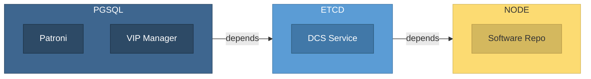

ETCD is a distributed, reliable key-value store for critical system configuration data.

Pigsty uses [**etcd**](https://etcd.io/) as a [**DCS**](https://patroni.readthedocs.io/en/latest/dcs_failsafe_mode.html) (Distributed Config Store). It is critical for PostgreSQL high availability and automatic failover.

The [`ETCD`](/docs/etcd) module depends on [`NODE`](/docs/node). The [`PGSQL`](/docs/pgsql) module requires [`ETCD`](/docs/etcd). Install [`NODE`](/docs/node) to manage nodes before you install [`ETCD`](/docs/etcd).

Deploy the [`ETCD`](/docs/etcd) cluster before any [`PGSQL`](/docs/pgsql) cluster. For PostgreSQL high availability, `patroni` and `vip-manager` depend on etcd. They use it for HA and to bind the L2 VIP to the primary.

One etcd cluster serves multiple PostgreSQL clusters in each Pigsty deployment.

Pigsty enables RBAC by default. Each PostgreSQL cluster uses separate credentials to isolate tenants. Administrators use the etcd root user, which has full permissions over all PostgreSQL clusters.
