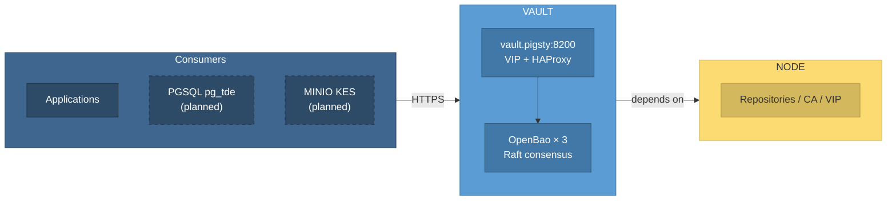

[OpenBao](https://openbao.org/) is an open-source key and secrets management system (MPL-2.0), forked by the community after HashiCorp Vault adopted the BSL license and hosted by the Linux Foundation. Its API is largely compatible with Vault.
Pigsty's **VAULT** module deploys an OpenBao cluster in the fixed `vault` group as the deployment's KMS (key management service) and secrets store. Pigsty manages TLS, auto-unseal, the HA endpoint, backups, monitoring, and lifecycle.

> [!NOTE] Current status: Beta
> VAULT is in Beta. Deployment, repeated execution, rolling restarts, standby read forwarding, VIP access, and snapshot backup/recovery have been validated on a three-member Ubuntu 24.04 cluster. Grafana display, alert behavior, and other operating systems still need validation.
> **Automatic integration is not yet implemented** for PGSQL `pg_tde` or MINIO KES; manual configuration is required. Test thoroughly in your own environment before production use, especially snapshot recovery.

VAULT follows the naming convention of the MINIO module and Silo engine: Pigsty uses the module name (`vault` group, `vault_*` parameters, `vault.yml` playbook, and `files/pki/vault/` directory), while the OS uses the engine name (`openbao.service`, `/etc/openbao/`, and the `bao` CLI).


--------

## Capabilities

The VAULT module currently provides:

- **Topology determines mode**: one member for labs, three for production, with no separate mode parameter. OpenBao's built-in Raft storage requires neither ETCD nor an external database.
- **Auto-unseal**: a 32-byte static seal key is generated on the admin node and distributed to members. Nodes unseal automatically after a restart, without manual key-share entry.
- **Safe initialization**: only the member with the lowest `vault_seq` runs `bao operator init`, once, after probing every member. Scaling or rebuilding a member cannot accidentally bootstrap a second empty cluster.
- **TLS throughout**: Pigsty CA signs server certificates, with TLS 1.3 as the minimum. Clients use `https://vault.pigsty:8200`.
- **HA endpoint**: NODE's L2 VIP and HAProxy provide TLS passthrough to the active member, switching automatically on failure.
- **Ready to use**: `secret/` (KV v2), `transit/` (encryption as a service), and `approle` authentication are enabled by default.
- **Rolling updates**: changes to configuration, certificates, the seal key, or the systemd unit restart members one at a time, waiting for each to rejoin before proceeding.
- **Daily snapshots**: each member retrieves a Raft snapshot from the active member daily and retains seven locally. An initial snapshot is taken immediately after initialization and retrieved to the admin node.
- **Observability**: Prometheus metrics over HTTPS, 14 recording rules, six alerts, and a Vault Overview dashboard. Service and backup logs go to VictoriaLogs.
- **Removal safeguards**: `vault_safeguard` is **enabled by default**, like MYSQL's `mysql_safeguard: true`. Removal never touches key material on the admin node.


--------

## Architecture

VAULT depends on [`NODE`](/docs/node) for node management, repositories, the shared CA, and L2 VIP, and on [`INFRA`](/docs/infra) for VictoriaMetrics, VictoriaLogs, Grafana, and Alertmanager.
It does not depend on [`ETCD`](/docs/etcd) or [`PGSQL`](/docs/pgsql). PGSQL (`pg_tde` transparent encryption) and MINIO (KES server-side encryption) are planned consumers.



A Pigsty deployment needs only one VAULT cluster. Consumers access it through the same domain, with separate mounts, policies, and credentials for isolation.

The trust roots reside on the admin node: the seal key, root token, and recovery keys are stored in `files/pki/vault/`, alongside the Pigsty CA private key at `files/pki/ca/ca.key`.
This follows Pigsty's existing security model: **backing up `files/pki` preserves all trust roots**.


--------

## Components and Ports

| Component | Purpose | Endpoint |
|:---|:---|:---|
| OpenBao API | Client access, inter-member forwarding, Prometheus metrics | `<node-IP>:8200`, `127.0.0.1:8200` |
| OpenBao Raft | Raft replication and elections | `<node-IP>:8201` |
| HAProxy endpoint | HA access on the VIP, with TLS passthrough to the active member (VIP enabled only) | `<VIP>:8200` |
| `vault-backup` | Daily Raft snapshot script scheduled by cron | `/usr/local/bin/vault-backup` |
| `bao` | OpenBao CLI; environment set by `/etc/profile.d/bao.sh` | Local node |
{.full-width}

OpenBao listens only on the node IP and loopback, not `0.0.0.0`, leaving `<VIP>:8200` for HAProxy. The client port is therefore always `8200` in both lab and production deployments.


--------

## Limitations

VAULT deliberately provides a small, fixed platform. Review these current limitations before use:

- **No automatic consumer integration yet**: mounts, policies, and credentials for PGSQL `pg_tde` and MINIO KES require manual configuration. The prefixes `tde/<pg_cluster>` and `kes/<minio_cluster>` are reserved for them.
- **Static seal security boundary**: the auto-unseal key resides on member nodes and cannot protect against a compromised VAULT or admin node. It protects leaked data disks, backups, and snapshots; see the [FAQ](/docs/vault/faq#is-auto-unseal-secure).
- **Long-lived credentials**: the root token remains on the admin node. Backup tokens last ten years, comparable to Pigsty certificates; no agent or renewal component is introduced.
- **No declarative application objects**: there is no `vault_apps` parameter. Create application policies and AppRoles manually with `bao`.
- **Routine snapshots remain local**: each member retains seven. The initial snapshot and the final snapshot before whole-cluster removal are retrieved automatically to the admin node. Other off-site replication is an operator responsibility, and recovery is manual.
- **No external Vault management**: existing HashiCorp Vault deployments and managed KMS services are not adopted.


--------

## Platform Support

The Pigsty Infra repository provides `openbao` (currently `2.7.2`, official native builds). It is included in the default `infra-package` alias and covers all supported platforms:

| Architecture | Supported Systems |
|:---|:---|
| `x86_64` | EL 8/9/10、Debian 12/13、Ubuntu 22/24/26 |
| `aarch64` | EL 8/9/10、Debian 12/13、Ubuntu 22/24/26 |
{.full-width}


--------

## Documentation

| Document | Description |
|:---|:---|
| [Configuration](/docs/vault/config) | Single-node and three-node topologies, VIP, DNS, key material, and filesystem layout |
| [Parameters](/docs/vault/param) | Eight public parameters and fixed conventions |
| [Playbooks](/docs/vault/playbook) | Tasks, tags, and commands for `vault.yml` and `vault-rm.yml` |
| [Administration](/docs/vault/admin) | Create, scale, rebuild members, renew certificates, back up, restore, and remove |
| [Usage](/docs/vault/usage) | KV, Transit, and AppRole through `bao` and the HTTP API |
| [Monitoring](/docs/vault/monitor) | Dashboards, scraping, logs, and alerts |
| [Metrics](/docs/vault/metric) | Recording rules and common raw metrics |
| [FAQ](/docs/vault/faq) | Cluster sizing, auto-unseal, initialization guards, and troubleshooting |
{.full-width}


--------

## Quick Start

Define the `vault` group in the [inventory](/docs/setup/config), and resolve `vault.pigsty` to its member:

```yaml
all:
  children:
    vault: { hosts: { 10.10.10.10: { vault_seq: 1 } }, vars: { vault_cluster: vault } }
  vars:
    node_etc_hosts: [ '10.10.10.10 vault.pigsty' ]   # All nodes access vault through this domain
```

After provisioning [`NODE`](/docs/node), run [`vault.yml`](/docs/vault/playbook#vaultyml):

```bash
./node.yml  -t node_hosts          # Write vault.pigsty into /etc/hosts on all nodes
./vault.yml -l vault               # Deploy the vault cluster (or use bin/vault-add)
```

[`deploy.yml`](/docs/setup/playbook) automatically deploys a predefined `vault` group, so a separate `vault.yml` run is unnecessary.

After deployment, check cluster status as root on a member:

```bash
sudo -i bao status                 # Healthy: Initialized=true, Sealed=false
```

The root token is stored on the admin node in `files/pki/vault/init.json`. See [Usage](/docs/vault/usage) to get started; open **Vault Overview** in Grafana to inspect the cluster.
