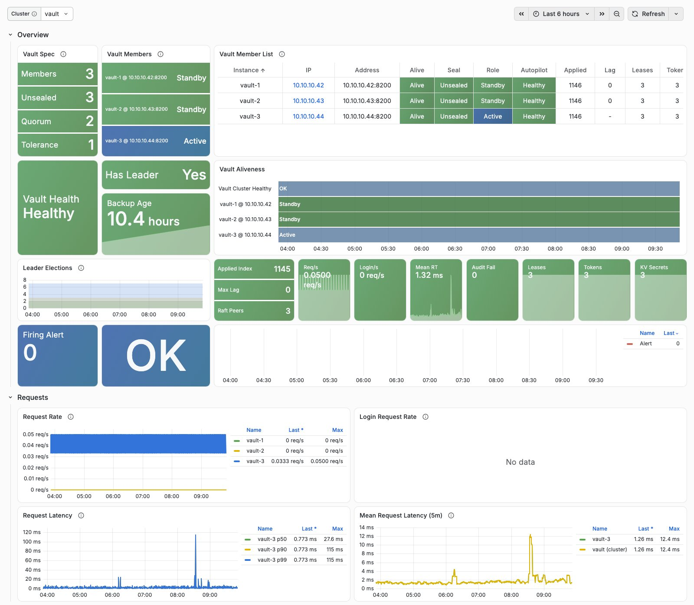

VAULT reuses Pigsty's observability stack. OpenBao metrics flow over HTTPS to VictoriaMetrics; service and backup logs flow through Journald / Vector to VictoriaLogs.
vmalert loads 14 recording rules and six alerts, and Grafana provides the Vault Overview dashboard.


--------

## Dashboard

VAULT provides one dashboard: Vault Overview.

### Vault Overview Dashboard

Vault Overview is available at `/ui/d/vault-overview`. Use the `Cluster` variable at the top to select a cluster.

[](/img/dashboard/vault-overview.jpg)

The initial **Overview** section shows:

- **Vault Spec**: members, unsealed members, quorum, and fault tolerance. **Vault Members**: each member's current role (Active / Standby / Sealed / Down).
- **Vault Member List**: availability, seal state, role, Autopilot health, Raft applied index, replication lag, lease/token counts, and time since the last snapshot.
- **Vault Health**: Autopilot cluster health. **Has Leader**: whether exactly one member is active. **Backup Age**: age of the oldest of the members' latest successful snapshots.
- **Vault Aliveness**: the main timeline. Its top band shows whether exactly one member is active; member bands use Active / Standby / Sealed colors, with red for unavailable members.
- **Leader Elections**, Raft statistics, request rate, average latency, audit failures, lease/secret counts, and active alerts.

Expand other groups for details:

| Group | Contents |
|:---|:---|
| Requests | Request/login rates, latency quantiles, and request-weighted mean latency |
| Raft Storage | Commit/applied indexes, FSM backlog, follower lag and heartbeats, commit latency, BoltDB size, fault tolerance, and peers |
| Secrets & Leases | Leases, tokens, token/lease operations, KV secrets, and identity entities |
| Audit | Audit write rates and failures |
| Runtime | Goroutines, memory, GC pauses, and heap objects |
| HA Forwarding | Standby-to-active forwarding rates and errors |
| Backup | Member snapshot times, sizes, and backup logs |
| Logs | OpenBao service log rates by level and log details |
{.full-width}


--------

## Metric Collection

Monitoring registration creates a file-discovery target on INFRA nodes for each member. VictoriaMetrics' `vault` scrape job consumes this directory:

```yaml
# /infra/targets/vault/vault-1.yml
- labels: { ip: 10.10.10.11 , ins: vault-1 , cls: vault }
  targets: [ 10.10.10.11:8200 ]
```

The job accesses `https://<ip>:8200/v1/sys/metrics?format=prometheus` directly and validates member certificates with Pigsty CA. Metrics share the API port and require no separate exporter:

- `unauthenticated_metrics_access` is enabled only on the node IP listener, so scraping **requires no token**. The loopback listener does not allow unauthenticated metrics.
- Scraping uses HTTPS. OpenBao's listeners provide TLS only; a separate plaintext metrics port is unnecessary.
- Sealed members remain scrapeable. `vault_up` indicates process/network reachability, while `vault_core_unsealed` indicates seal state.

After each successful snapshot, `vault-backup` writes two metrics to `/var/lib/node_exporter/textfile/vault.prom`. node_exporter collects them, and rules associate them with VAULT instances by `ip`.

VAULT metrics carry `job="vault"`, `cls`, `ins`, `ip`, and `instance`. See [Metrics](/docs/vault/metric) for details.


--------

## Logs

OpenBao runs under systemd and logs to Journald. Vector collects those logs into VictoriaLogs. Scheduled `vault-backup` output uses `logger -t vault-backup` and follows the same path.
Use these LogsQL queries in Grafana:

```bash
job:syslog unit:openbao                  # OpenBao service logs
job:syslog app:="vault-backup"           # Snapshot backup logs
```

Audit logs remain in `/var/log/openbao/audit.log` on members, rotated daily with seven files retained. They are **not** collected into VictoriaLogs. They include request paths and client information; configure centralized collection to meet your requirements.

If an audit device cannot write, for example because the disk is full, OpenBao rejects all requests. `VaultAuditFailure` covers this condition.


--------

## Alert Rules

VAULT provides six alerts in [`files/victoria/rules/vault.yml`](https://github.com/pgsty/pigsty/blob/main/files/victoria/rules/vault.yml):

| Alert | Severity | Condition | Description |
|:---|:---:|:---|:---|
| `VaultDown` | CRIT | `vault_up < 1` for 1 minute | Member metrics cannot be scraped: process stopped or network unreachable |
| `VaultSealed` | WARN | `vault_core_unsealed < 1` for 1 minute | Sealed member cannot serve keys; a sealed single-member cluster also triggers CRIT `VaultNoLeader` |
| `VaultNoLeader` | CRIT | `vault:cls:active != 1` for 30 seconds | No active member, or more than one |
| `VaultAuditFailure` | CRIT | Audit write failures over 5 minutes exceed zero, for 1 minute | OpenBao rejects requests when audit writes fail; check disk |
| `VaultNoFailureTolerance` | WARN | Fault tolerance below one in a cluster of at least three members, for 2 minutes | One more member failure would lose quorum |
| `VaultBackupStale` | WARN | No successful member snapshot in 26 hours, or ever, for 5 minutes | Check `journalctl -t vault-backup` and node_exporter |
{.full-width}

INFRA's generic `AgentDown` alert excludes the `vault` job to avoid duplicating `VaultDown`.

The following excerpt reproduces the current rule source:

```yaml

# metrics scrape failure: process down or unreachable (sealed members are still scraped)
- alert: VaultDown
  expr: vault_up < 1
  for: 1m
  labels: { level: 0, severity: CRIT, category: vault }
  annotations:
    summary: "CRIT VaultDown {{ $labels.ins }}@{{ $labels.instance }}"
    description: |
      vault_up[ins={{ $labels.ins }}, instance={{ $labels.instance }}] = {{ $value }} < 1
      metrics of the member can not be scraped: check openbao service on {{ $labels.ip }}
      /ui/d/vault-overview?var-cls={{ $labels.cls }}

# member reports itself sealed: a sealed single node also triggers VaultNoLeader
- alert: VaultSealed
  expr: vault_core_unsealed{job="vault"} < 1
  for: 1m
  labels: { level: 1, severity: WARN, category: vault }
  annotations:
    summary: "WARN VaultSealed {{ $labels.ins }}@{{ $labels.instance }}"
    description: |
      vault_core_unsealed[ins={{ $labels.ins }}] = {{ $value }} < 1
      the member is sealed and can not serve keys: check `bao status` on {{ $labels.ip }}
      /ui/d/vault-overview?var-cls={{ $labels.cls }}

# not exactly one active member observed: kms outage for cache misses & restarts
- alert: VaultNoLeader
  expr: vault:cls:active != 1
  for: 30s
  labels: { level: 0, severity: CRIT, category: vault }
  annotations:
    summary: "CRIT VaultNoLeader: {{ $labels.cls }} {{ $value }}"
    description: |
      vault:cls:active[cls={{ $labels.cls }}] = {{ $value }} != 1
      /ui/d/vault-overview?from=now-5m&to=now&var-cls={{ $labels.cls }}

# audit device rejects writes: openbao rejects requests, check disk
- alert: VaultAuditFailure
  expr: vault:ins:audit_failure_5m > 0
  for: 1m
  labels: { level: 0, severity: CRIT, category: vault }
  annotations:
    summary: "CRIT VaultAuditFailure: {{ $labels.cls }} {{ $labels.ins }}"
    description: |
      vault:ins:audit_failure_5m[ins={{ $labels.ins }}] = {{ $value | printf "%.0f" }} > 0
      requests are rejected while the audit log can not be written, check disk on {{ $labels.ip }}
      /ui/d/vault-overview?var-cls={{ $labels.cls }}

# production cluster (3+ members) can not survive another member failure
- alert: VaultNoFailureTolerance
  expr: >-
    (vault:cls:failure_tolerance < 1)
    and on (job,cls) (count by (job,cls) (vault_up) >= 3)
  for: 2m
  labels: { level: 1, severity: WARN, category: vault }
  annotations:
    summary: "WARN VaultNoFailureTolerance: {{ $labels.cls }} {{ $value }}"
    description: |
      vault:cls:failure_tolerance[cls={{ $labels.cls }}] = {{ $value }} < 1
      losing one more member loses quorum
      /ui/d/vault-overview?var-cls={{ $labels.cls }}

# no successful local snapshot on the member for 26h (or never)
- alert: VaultBackupStale
  expr: time() - (vault:ins:backup_time or vault_up * 0) > 26 * 3600
  for: 5m
  labels: { level: 1, severity: WARN, category: vault }
  annotations:
    summary: "WARN VaultBackupStale {{ $labels.ins }}@{{ $labels.instance }}"
    description: |
      last successful snapshot of {{ $labels.ins }} is {{ $value | humanizeDuration }} ago (or never)
      check `journalctl -t vault-backup` and node_exporter on {{ $labels.ip }}
      /ui/d/vault-overview?var-cls={{ $labels.cls }}
```
