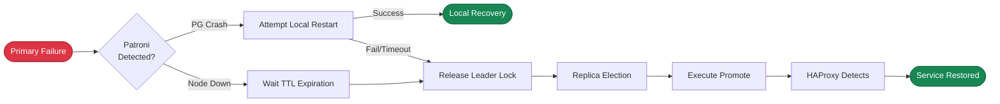

# RTO Trade-offs

> Trade-off analysis for RTO (Recovery Time Objective), finding the optimal balance between recovery speed and false failover risk.

---

LLMS index: [llms.txt](/llms.txt)

---

**RTO** (Recovery Time Objective) defines the **maximum time required for the system to restore write capability** when the primary fails.

Critical transaction systems typically need the shortest practical RTO, often below one minute.

Shorter RTO increases false failover risk. Network jitter can appear to be a failure. Cross-datacenter or cross-region deployments often allow 1–2 minutes to reduce this risk.

--------

## Trade-offs

[**`pg_rto`**](/docs/pgsql/param#pg_rto) controls the failover unavailability limit. Presets `fast`, `norm`, `safe`, and `wide` support different network and deployment conditions. The default is `norm`, approximately 45 seconds.

Recovery includes detection, DCS lock expiration, election, promotion, and HAProxy detection of the new primary. Shorter phase timeouts reduce RTO. They also increase sensitivity to network jitter and false failover risk.

Choose a preset that balances **recovery speed** and **false failover risk** for your network. Poor networks need longer timeouts. Stable networks can use shorter timeouts.




-----------------

## Four Modes

Select one of four RTO presets for the network conditions.

| **Name**                |                    **fast**                    |                   **norm**                   |                  **safe**                   |                    **wide**                    |
|:------------------------|:----------------------------------------------:|:--------------------------------------------:|:-------------------------------------------:|:----------------------------------------------:|
| **Use Case**            |                   Same rack                    |          Same datacenter (default)           |            Same region, cross-DC            |             Cross-region/continent             |
| **Network**             |               < 1ms, very stable               |                1-5ms, normal                 |              10-50ms, cross-DC              |           100-200ms, public network            |
| **Target RTO**          |   <span class="text-success">**30s**</span>    |  <span class="text-primary">**45s**</span>   |  <span class="text-warning">**90s**</span>  |   <span class="text-danger">**150s**</span>    |
| **False Failover Risk** | <span class="text-secondary">**Higher**</span> | <span class="text-primary">**Medium**</span> | <span class="text-success">**Lower**</span> | <span class="text-success">**Very Low**</span> |
| **Configuration**       |                 `pg_rto: fast`                 |                `pg_rto: norm`                |               `pg_rto: safe`                |                 `pg_rto: wide`                 |
{.full-width}


> [!IMPORTANT] fast: Same Rack/Switch
> - Use for stable networks below 1ms latency, such as one rack or switch.
> - Average RTO: **14s**; worst case: **29s**. TTL is 20s; check interval is 5s.
> - This needs the best network quality. Jitter can trigger failover, so **false failover risk is higher**.

> [!TIP] norm: Same Datacenter (Default)
> - **Default mode** for normal same-datacenter networks, 1–5ms latency, and reasonable packet loss.
> - Average RTO: **21s**; worst case: **43s**. TTL is 30s, allowing some network variation.
> - This balances recovery speed and stability for most production environments.

> [!NOTE] safe: Same Region, Cross-Datacenter
> - Use for same-region or same-area datacenters with 10–50ms latency and occasional jitter.
> - Average RTO: **43s**; worst case: **91s**. TTL is 60s.
> - The 60s primary restart wait allows more local recovery time and **reduces false failover risk**.

> [!CAUTION] wide: Cross-Region/Continent
> - Use across regions or continents with 100–200ms latency and possible public-network packet loss.
> - Average RTO: **92s**; worst case: **207s**. TTL is 120s.
> - Slower recovery provides a very low false failover rate for geographic disaster recovery.

--------

## RTO Timeline

Patroni HA has two main paths. **Active detection** finds a PostgreSQL crash and attempts a restart. **Passive lease expiration** waits for the TTL after node failure, then starts an election.

<script>
window.OinkEchartsFunctions = window.OinkEchartsFunctions || {};
(function (registry) {
var fmt = function(params) { if (!params || !params.length || params[0].name === '') return ''; return '<b>' + params[0].name + '</b><br/>' + params.filter(p => p.value !== '-' && p.value != null).map(p => p.marker + ' ' + p.seriesName + ': ' + p.value + 's').join('<br/>'); };
registry["fmt"] = fmt;
})(window.OinkEchartsFunctions);
</script>

```echarts {height="820px"}
tooltip: { trigger: axis, axisPointer: { type: shadow }, formatter: $fn:fmt }
legend: { top: 0, itemGap: 10, data: [Lease Expiration, Failure Detection, Restart Timeout, Replica Detection, Lock & Promote, Health Check] }
grid: { left: 110, right: 24, bottom: 32, top: 40 }
xAxis: { type: value, name: Seconds, nameLocation: end, max: 160, axisLine: { show: true }, axisTick: { show: true }, splitLine: { show: true, lineStyle: { type: dashed, opacity: 0.5 } }, minorTick: { show: true, splitNumber: 5 }, minorSplitLine: { show: true, lineStyle: { type: dotted, opacity: 0.2 } } }
yAxis: { type: category, axisLine: { show: true }, axisTick: { show: true }, splitLine: { show: false }, axisLabel: { fontSize: 9, fontFamily: monospace }, data: [wide-passive-max, wide-passive-avg, wide-passive-min, wide-active-max, wide-active-avg, wide-active-min, "", safe-passive-max, safe-passive-avg, safe-passive-min, safe-active-max, safe-active-avg, safe-active-min, "", norm-passive-max, norm-passive-avg, norm-passive-min, norm-active-max, norm-active-avg, norm-active-min, "", fast-passive-max, fast-passive-avg, fast-passive-min, fast-active-max, fast-active-avg, fast-active-min] }
series:
  - { name: Lease Expiration, type: bar, stack: main, barWidth: 16, z: 2, emphasis: { focus: series }, itemStyle: { color: "#e15759" }, data: [120, 110, 100, "-", "-", "-", "-", 60, 55, 50, "-", "-", "-", "-", 30, 27, 25, "-", "-", "-", "-", 20, 17, 15, "-", "-", "-"] }
  - { name: Failure Detection, type: bar, stack: main, z: 2, emphasis: { focus: series }, itemStyle: { color: "#b07aa1" }, data: ["-", "-", "-", 20, 10, 0, "-", "-", "-", "-", 10, 5, 0, "-", "-", "-", "-", 5, 3, 0, "-", "-", "-", "-", 5, 3, 0] }
  - { name: Restart Timeout, type: bar, stack: main, z: 2, emphasis: { focus: series }, itemStyle: { color: "#f28e2c" }, data: ["-", "-", "-", 95, 95, 0, "-", "-", "-", "-", 45, 45, 0, "-", "-", "-", "-", 25, 25, 0, "-", "-", "-", "-", 15, 15, 0] }
  - { name: Replica Detection, type: bar, stack: main, z: 2, emphasis: { focus: series }, itemStyle: { color: "#edc949" }, data: [20, 10, 0, 20, 10, 0, "-", 10, 5, 0, 10, 5, 0, "-", 5, 3, 0, 5, 3, 0, "-", 5, 3, 0, 5, 3, 0] }
  - { name: Lock & Promote, type: bar, stack: main, z: 2, emphasis: { focus: series }, itemStyle: { color: "#59a14f" }, data: [2, 1, 0, 2, 1, 0, "-", 2, 1, 0, 2, 1, 0, "-", 2, 1, 0, 2, 1, 0, "-", 2, 1, 0, 2, 1, 0] }
  - { name: Health Check, type: bar, stack: main, z: 2, emphasis: { focus: series }, itemStyle: { color: "#4e79a7" }, data: [8, 6, 4, 8, 6, 4, "-", 6, 5, 3, 6, 5, 3, "-", 4, 3, 2, 4, 3, 2, "-", 2, 2, 1, 2, 2, 1] }
  - { name: RTO Total, type: bar, barGap: "-100%", barWidth: 16, z: 1, itemStyle: { color: "#888", opacity: 0 }, emphasis: { itemStyle: { opacity: 0 } }, data: [150, 127, 104, 145, 122, 4, "-", 78, 66, 53, 73, 61, 3, "-", 41, 34, 27, 41, 35, 2, "-", 29, 23, 16, 29, 24, 1] }
  - { name: RTO Budget, type: bar, barGap: "-100%", barWidth: 16, z: 0, itemStyle: { color: "rgba(0,0,0,0.08)" }, emphasis: { itemStyle: { color: "rgba(0,0,0,0.12)" } }, data: [150, 150, 150, 150, 150, 150, "-", 90, 90, 90, 90, 90, 90, "-", 45, 45, 45, 45, 45, 45, "-", 30, 30, 30, 30, 30, 30] }
```


------

## Implementation

Each preset selects values for these 10 **Patroni** and **HAProxy** parameters:

|   Component   |          Parameter          | **fast** | **norm** | **safe** | **wide** | Description                           |
|:-------------:|:---------------------------:|:--------:|:--------:|:--------:|:--------:|:--------------------------------------|
| **`patroni`** |          **`ttl`**          |    20    |    30    |    60    |   120    | Leader lock TTL (seconds)             |
|               |       **`loop_wait`**       |    5     |    5     |    10    |    20    | HA loop check interval (seconds)      |
|               |     **`retry_timeout`**     |    5     |    10    |    20    |    30    | DCS operation retry timeout (seconds) |
|               | **`primary_start_timeout`** |    15    |    25    |    45    |    95    | Primary restart wait time (seconds)   |
|               |     **`safety_margin`**     |    5     |    5     |    10    |    15    | Watchdog safety margin (seconds)      |
| **`haproxy`** |         **`inter`**         |    1s    |    2s    |    3s    |    4s    | Normal state check interval           |
|               |       **`fastinter`**       |  500ms   |    1s    |  1500ms  |    2s    | State transition check interval       |
|               |       **`downinter`**       |    1s    |    2s    |    3s    |    4s    | DOWN state check interval             |
|               |         **`rise`**          |    3     |    3     |    3     |    3     | Consecutive successes to mark UP      |
|               |         **`fall`**          |    3     |    3     |    3     |    3     | Consecutive failures to mark DOWN     |
{.full-width}


### Patroni Parameters

- **`ttl`**: Leader lease lifetime. Failure to renew triggers expiration and election. It sets passive detection delay.
- **`loop_wait`**: Main loop interval. Each cycle checks health and synchronizes state.
- **`retry_timeout`**: DCS retry period. After partition-related retries fail, the primary demotes to prevent split brain.
- **`primary_start_timeout`**: Time allowed for local restart after a PostgreSQL crash. On expiration, release the Leader lock and fail over.
- **`safety_margin`**: Watchdog time allowance for restarting the system before split brain can occur.

### HAProxy Parameters

- **`inter`**: Check interval while service state is stable.
- **`fastinter`**: Shorter check interval during state changes.
- **`downinter`**: Check interval for recovery after a service is marked DOWN.
- **`rise`**: Consecutive successes required for UP. A new primary must pass this many checks before receiving traffic.
- **`fall`**: Consecutive failures required for DOWN.

### Key Constraint

**Patroni constraint**: The primary must complete demotion before TTL expiration to prevent split brain.

```math
loop\_wait + 2 \times retry\_timeout \leq ttl
```

------

## Data Summary

------

## Recommendations

**fast** requires latency below 1ms and very low packet loss. Use it only within one rack or switch for strict RTO targets. Test it thoroughly in production before enabling it.

**norm** is the default for most same-datacenter deployments. This page's model gives passive and active averages of about 34 and 35 seconds. Its timeout allowance reduces false failovers from jitter.

**safe** suits same-city datacenters with higher latency or occasional jitter. Longer timeouts reduce false failovers. It is recommended for cross-datacenter recovery.

**wide** suits high-latency, cross-region or cross-continent networks, including public-network packet loss. It favors stability over speed. Its long timeouts keep false failover rates very low.

|  Mode     | Target RTO |       Passive RTO        |      Active RTO       | Scenario           |
|:---------:|:-----:|:---------------------:|:-------------------:|:-------------|
|  `fast`   | `30`  |  `16` / `23` / `29`   |  `1` / `24` / `29`  | Same switch, high-quality network   |
|  `norm`   | `45`  |  `27` / `34` / `41`  |  `2` / `35` / `41`  | Default, same DC, standard network  |
|  `safe`   | `90`  |  `53` / `66` / `78`   |  `3` / `61` / `73`  | Same-city active-active / cross-DC DR |
|  `wide`   | `150` | `104` / `127` / `150` | `4` / `122` / `145` | Geo-DR / cross-country  |
| `default` | `326` |  `22` / `34` / `46`   | `2` / `314` / `326` | Patroni default params |
{.full-width}


Set [**`pg_rto`**](/docs/pgsql/param#pg_rto) to a preset name to configure Patroni and HAProxy automatically. The template checks `pg_rto in pg_rto_plan`. A numeric or unknown key falls back to `norm`. This fallback does not support an RTO expressed as seconds.

Presets come from [**`pg_rto_plan`**](/docs/pgsql/param#pg_rto_plan). Override this mapping for a custom RTO strategy.

```yaml
pg_rto_plan:  # [ttl, loop, retry, start, margin, inter, fastinter, downinter, rise, fall]
  fast: [ 20  ,5  ,5  ,15 ,5  ,'1s' ,'500ms'  ,'1s' ,3 ,3 ]  # rto < 30s
  norm: [ 30  ,5  ,10 ,25 ,5  ,'2s' ,'1s'     ,'2s' ,3 ,3 ]  # rto < 45s
  safe: [ 60  ,10 ,20 ,45 ,10 ,'3s' ,'1500ms' ,'3s' ,3 ,3 ]  # rto < 90s
  wide: [ 120 ,20 ,30 ,95 ,15 ,'4s' ,'2s'     ,'4s' ,3 ,3 ]  # rto < 150s
```
