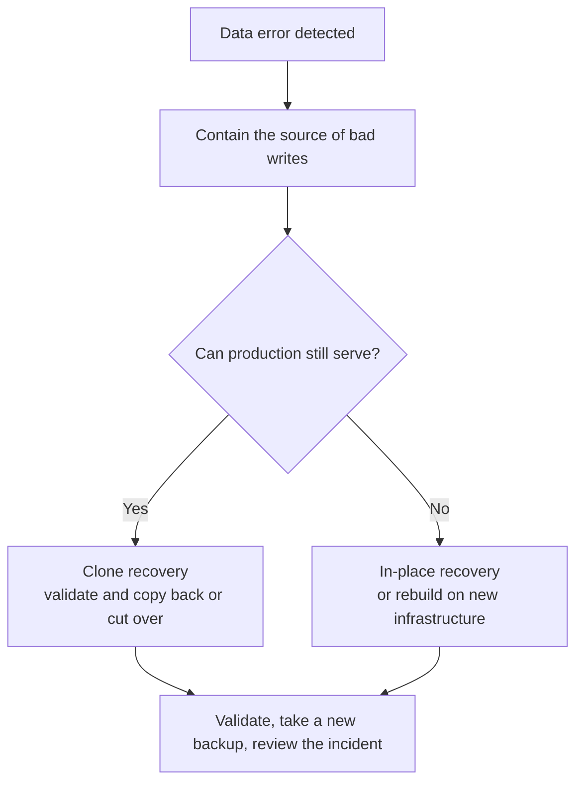

# PITR Scenarios

> How to choose a recovery target and workflow for accidental DML, dropped objects, defective releases, investigations, and site loss — and why recovery drills must be routine.

---

LLMS index: [llms.txt](/llms.txt)

---

Decisions can consume much of the available incident response time. Pigsty automates recovery steps, but the operator must decide three things. **Select the target, choose in-place or clone recovery, and define how to validate the result.**

Read and rehearse this framework before an incident.


----------------

## Decision Framework

| Scenario | Typical problem | Recommended workflow | Target |
|:---------|:----------------|:---------------------|:-------|
| Accidental DML | `DELETE` or `UPDATE` affects the wrong rows | Clone, validate, then copy back data | `time` / `xid` |
| Dropped table, schema, or database | `DROP` or an incorrect migration | Clone, validate, then copy back objects | `time` / `name` |
| Defective release or batch corruption | Software writes incorrect data for a period | Clone and compare before choosing repair or cutover | `time` / `xid` |
| Audit, investigation, or forensics | Inspect historical state | Clone and hold at the target for inspection | `time` / `lsn` |
| Whole-cluster or site loss | Hosts or storage are gone or encrypted | Recover in place on replacement infrastructure | `default` / `time` |
{.full-width}

Two principles apply throughout:

* **Stop the damage first.** Before selecting a target, pause the defective application or remove its write access. The recovery window keeps moving. However, restoring the wrong cluster in haste can cause another incident.
* **Prefer a clone while production is usable.** A clone leaves the source unchanged. You can try multiple targets and validate before export or cutover. Recovery overwrites the selected destination cluster. Use in-place recovery when the whole cluster is unusable or the business explicitly accepts rolling back every database.




----------------

## Accidental DML

Common PITR cases include `DELETE` without `WHERE`, an incorrect `UPDATE`, and defective batch jobs.

Find the error in application logs, PostgreSQL logs, metrics, or audit records. A timestamp is usually sufficient. If you know the exact transaction ID, use `xid` with `exclusive: true` to stop immediately before it.

```bash
# If the deletion occurred around 10:15, clone the state from 10:14
./pgsql-pitr.yml -l pg-test -e '{"pg_pitr": { "cluster": "pg-meta", "time": "2026-07-11 10:14:00+08", "archive": false, "action": "promote" }}'

# If the deleting transaction was 250000, stop immediately before it
./pgsql-pitr.yml -l pg-test -e '{"pg_pitr": { "cluster": "pg-meta", "xid": "250000", "exclusive": true, "archive": false, "action": "promote" }}'
```

Validate the recovered rows. Copy only required data back with `pg_dump`, `COPY`, or an application-specific reconciliation procedure. A configured [**delayed cluster**](/docs/pgsql/config/cluster/#delayed-cluster) may provide faster access if it remains within its delay window.


----------------

## Dropped Objects

Use the same approach for `DROP TABLE`, `DROP DATABASE`, or a migration in the wrong environment. Prefer a clone more strongly in these cases. Whole-cluster rollback to recover one object also discards every valid write after the target.

Restore a separate destination to before the DDL. Validate the object, export it with `pg_dump`, and import it into production. Before planned high-risk changes, create a restore point with `pg_create_restore_point()`. A `name` target avoids timestamp ambiguity.


----------------

## Defective Release or Batch Corruption

A faulty release can corrupt data for hours. Identify the last correct state and the full impact. Restore a clone to candidate times and compare it with production. Then decide whether to copy corrected rows back or switch to a recovered cluster.

The application owner must validate this decision. Successful PostgreSQL recovery proves consistency at the target. It does not prove that the business state is correct.


----------------

## Audit and Investigation

Historical questions, such as a month-end balance, require historical data. Restore a separate destination to a time, LSN, XID, or named point. Inspect it without changing the source.

Targeted recovery defaults to `action: pause`, which holds recovery at the target for inspection. This option does **not** configure read-only access or create a separate cluster. The inventory limit and `cluster` source field determine the destination workflow. For an operator checkpoint before promotion, run `-t down`, `-t pitr`, and `-t up` separately. Explicitly enforce read-only access if required for investigation. `immediate` stops at the first consistent point; it does not select a historical timestamp.


----------------

## Site Loss

HA cannot help if every database host is destroyed or encrypted. The repository and other control-plane assets must survive **outside that failure domain**. Possible repositories include Silo/S3, another protected host or filesystem, and other tested pgBackRest backends. A remote object store is recommended. The essential requirement is survival in an independent failure domain.

Rebuild the hosts and restore the inventory, credentials, and PKI. Select the surviving repository, then restore through the latest archived WAL:

```bash
./pgsql-pitr.yml -l pg-meta -e '{"pg_pitr": {"action": "promote"}}'
```

Inventory and backups alone are insufficient. Preserve installation media or package repositories, repository credentials, encryption passwords, CA material, custom files, and DNS dependencies. Keep an independently accessible runbook. Encrypt secrets and store them separately from database hosts and ordinary source control.


----------------

## Make Recovery a Routine Drill

Do not run these procedures for the first time during a production incident. Rehearse clone recovery regularly on a disposable destination. Repeat after major architecture changes. Measure these outcomes:

1. **Usability:** can the backup and complete WAL chain be restored and validated?
2. **RTO:** how long does the actual restore and replay take now?
3. **Operator readiness:** can the on-call engineer identify source and destination, select a target, and follow the safety gates?

See [**Restore Operations**](/docs/pgsql/backup/restore/) and [**Clone a Database Cluster**](/docs/pgsql/backup/cluster/) for the task-level runbooks.
