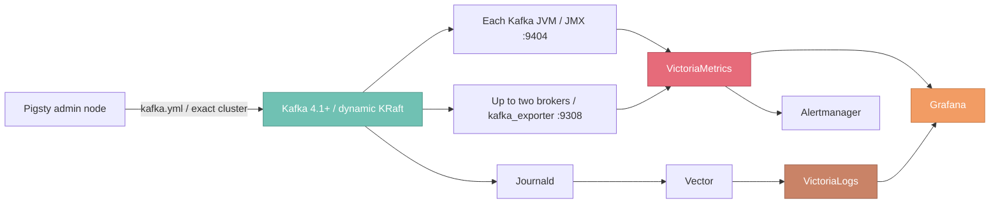

# Module: KAFKA

> Deploy, secure, and monitor Apache Kafka 4.1+ dynamic KRaft clusters with Pigsty.

---

LLMS index: [llms.txt](/llms.txt)

---

> [!NOTE] Source Version Scope
> This page follows the current development source snapshot. `kafka_jmx_exporter_enabled` was added on 2026-09-01. The released `v4.5.0` tag does not include it: JMX is always enabled there, and the persistent public parameter count remains 15. The 16 parameters and JMX-disable procedure described here apply to sources containing that change.

[Kafka](https://kafka.apache.org/) is a distributed event-streaming platform. Pigsty's [`KAFKA`](/docs/kafka) module installs **Apache Kafka 4.1+ dynamic KRaft** clusters on managed nodes from RPM/DEB packages. It manages security, resources, lifecycle, and observability.

> [!NOTE] Current status: Beta module
> Kafka is a Beta module. Before production use, test it thoroughly and verify that it meets your requirements.
> Test dynamic KRaft, strict rolling restarts, TLS/SCRAM/ACL, declared topics and users, credential and certificate rotation, and the complete monitoring pipeline.

--------

## Module Capabilities

The KAFKA module currently provides:

- Native dynamic KRaft, without ZooKeeper or static `controller.quorum.voters`.
- Native roles `combined`, `broker`, and `controller`, with combined or separate control and data planes.
- Random Cluster ID and Controller Directory IDs for new clusters. A minimal bootstrap manifest freezes these values and blocks conflicting operations.
- Lifecycle selection from live health: cold start or repair, serial broker admission, dynamic controller join, or strict single-node rolling restart.
- Checks before and after each rolling step: controller majority, voter catch-up, offline partitions, under-min-ISR, and ISR catch-up.
- Member retirement and failed-node replacement through playbooks. `kafka-rm.yml` retires a strict subset, including dead nodes. Node replacement uses three commands.
- `plaintext` and production `scram` profiles. The latter provides TLS, SCRAM-SHA-512, controller mTLS, ACLs, and default-deny authorization.
- Declarative topics, credentials, ACLs, and quotas without implicit deletion. Protected internal credential and certificate rotation.
- JMX and protocol exporters, 19 recording rules, 15 alert rules, four Grafana dashboards, and VictoriaLogs storage.

--------

## Module Architecture

[`NODE`](/docs/node) provides node management, package repositories, and base monitoring. [`INFRA`](/docs/infra) provides VictoriaMetrics, VictoriaLogs, Grafana, and Alertmanager. KAFKA depends on both.

By default, every Kafka JVM includes JMX Exporter and registers as `job=kafka`. Disable it per instance with [`kafka_jmx_exporter_enabled`](/docs/kafka/param#kafka_jmx_exporter_enabled). `kafka_exporter` runs on the first two broker-capable nodes, ordered by `kafka_seq`. A single broker runs one exporter; pure controllers run none. Both exporters report the same logical cluster. Recording rules deduplicate their metrics before aggregation.

--------

## Documentation

| Document                             | Contents                                                              |
|:-----------------------------------|:--------------------------------------------------------------------|
| [Quickstart](/docs/kafka/start)    | From a single node to a three-node secure cluster: client access, parameter changes, and go-live checks |
| [Cluster Config](/docs/kafka/config)   | Topology, dynamic KRaft, network, storage, security, and resource declarations |
| [Parameters](/docs/kafka/param)    | 16 persistent public parameters plus transient operational variables |
| [Administration](/docs/kafka/admin)    | Status checks, topics, messages, consumer groups, and topology changes |
| [Playbook](/docs/kafka/playbook) | `kafka.yml` lifecycle, task tags, rotation, and teardown safeguards |
| [Monitoring](/docs/kafka/monitor)  | Metrics pipeline, dashboards, log queries, and alert rules |
| [Metrics](/docs/kafka/metric)   | Metric dictionary for JMX, the protocol exporter, and recording rules |
| [FAQ](/docs/kafka/faq)      | Questions on roles, identity, security, exporters, and scaling |
{.full-width}

--------

## First Time

Follow [Quickstart](/docs/kafka/start) to build a single-node development cluster, then a three-node TLS/SCRAM/ACL cluster. Continue with client access, parameter and resource changes, and deployment checks.

If you know Kafka and Pigsty, start with [Cluster Config](/docs/kafka/config) or [Parameters](/docs/kafka/param).

--------

## Default Ports

|  Port  | Service          | Deployment scope        | `plaintext` | `scram`                  |
|:------:|:-----------------|:-----------------------|:------------|:-------------------------|
| `9092` | Kafka Broker     | Broker-capable nodes    | PLAINTEXT   | SASL_SSL + SCRAM-SHA-512 |
| `9093` | KRaft Controller | Controller-capable nodes | PLAINTEXT   | Mutual TLS               |
| `9308` | kafka_exporter   | Up to two broker-capable nodes | HTTP metrics | HTTP metrics, TLS/SCRAM on the backend |
| `9404` | JMX Exporter     | Kafka nodes with JMX enabled | HTTP metrics | HTTP metrics             |
{.full-width}

All four ports must be different. Parameters can change each port. Restrict JMX and protocol exporter HTTP ports to the monitoring network through firewalls.

--------

## Current Boundaries

This role provides a core Kafka deployment baseline. A complete streaming platform or managed service requires additional components or procedures for:

- Existing partition reassignment and replica balancing after expansion. Playbooks manage member join, retirement, and replacement, but data movement needs an explicit plan.
- Increasing the frozen `default.replication.factor` after expansion. Kafka 4.3 requires explicit data migration and a static-configuration maintenance window.
- Changing existing topic replication factors, deleting topics, and deleting users.
- Migrating formatted clusters online from `plaintext` to `scram`.
- Kafka upgrades, feature-level finalization, backup, restore, and disaster exercises.
- Multiple listeners, NAT or public addresses, multiple client networks per broker, and tiered storage.
- Kafka Connect, Schema Registry, MirrorMaker 2, Cruise Control, and web interfaces.

Document these limits in production plans, approval processes, and exercises. Running the ordinary inventory again does not perform these operations.

---

Section pages:

- [Quick Start](/docs/kafka/start/): Deploy single-node and 3-node Kafka clusters from scratch, with secure access, parameter tuning, and launch checklist.
- [Configuration](/docs/kafka/config/): Plan Kafka dynamic KRaft topology, identity, network, storage, security, and declarative resources.
- [Parameters](/docs/kafka/param/): 16 persistent public parameters and transient protected operational variables of the KAFKA module.
- [Administration](/docs/kafka/admin/): Kafka status checks, topic and user management, config changes, scaling, failed-node replacement, and security rotation.
- [Playbook](/docs/kafka/playbook/): Run dynamic KRaft lifecycle, strict rolling, resource convergence, rotation, and removal with kafka.yml and kafka-rm.yml.
- [Monitoring](/docs/kafka/monitor/): Kafka metrics collection, Grafana dashboards, log queries, and alerting rules.
- [Metrics](/docs/kafka/metric/): Kafka JMX, protocol exporter, and recording rule metrics dictionary.
- [FAQ](/docs/kafka/faq/): Frequently asked questions about the Pigsty Kafka 4.1+ dynamic KRaft module.
