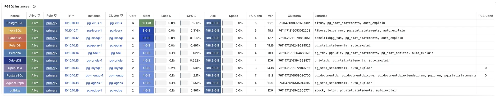

# PG Kernels

> How to use PostgreSQL kernel forks in Pigsty, such as Citus, Babelfish, IvorySQL, PolarDB, and more.

---

LLMS index: [llms.txt](/llms.txt)

---

In Pigsty, you can replace the native PostgreSQL kernel with a variant that provides specialized features.

Pigsty supports multiple PostgreSQL kernels and compatibility branches within one operational framework.
These kernels provide compatibility layers, multi-master replication, graph queries, MPP warehousing, transparent encryption, and other features.

The level of Pigsty integration differs between kernels.
PostgreSQL, Citus, Babelfish, IvorySQL, PolarDB, AgensGraph, and pgEdge have defined templates and configuration procedures.
Cloudberry and Greenplum usually use `gpsql` mode.
For their MPP initialization and scale-out operations, upstream tools remain the preferred method.

| Kernel                                          | Key Feature                           | Description                                   |
|:------------------------------------------------|:--------------------------------------|:----------------------------------------------|
| [**PostgreSQL**](/docs/pgsql)                   | **Native kernel, full extension set** | Vanilla PostgreSQL with 625 extensions        |
| [**Supabase**](/docs/pgsql/kernel/supabase)     | **Backend as a Service**              | PostgreSQL-based BaaS, Firebase alternative   |
| [**Citus**](/docs/pgsql/kernel/citus)           | **Horizontal scaling**                | Distributed PostgreSQL via native extension   |
| [**Babelfish**](/docs/pgsql/kernel/babelfish)   | **SQL Server compatible**             | SQL Server wire-protocol compatibility (PG17/18) |
| [**IvorySQL**](/docs/pgsql/kernel/ivorysql)     | **Oracle compatible**                 | Oracle syntax and PL/SQL compatibility        |
| [**OpenHalo**](/docs/pgsql/kernel/openhalo)     | **MySQL compatible**                  | MySQL wire-protocol compatibility             |
| [**Percona**](/docs/pgsql/kernel/percona)       | **Transparent data encryption**       | Percona distribution with pg_tde              |
| [**DocumentDB**](/docs/pgsql/kernel/documentdb) | Native PostgreSQL; use the instance's `SELECT version()` | Native PostgreSQL; use the instance's `SELECT version()` |
| [**OrioleDB**](/docs/pgsql/kernel/orioledb)     | **OLTP optimization**                 | UNDO-based storage engine with index-organized tables and S3 support                   |
| [**PolarDB**](/docs/pgsql/kernel/polardb)       | **Aurora-style RAC**                  | RAC, China-local compliance scenario          |
| [**Cloudberry**](/docs/pgsql/kernel/cloudberry) | **Open-source MPP warehouse**         | Cloudberry integrated through `gpsql` mode    |
| [**AgensGraph**](/docs/pgsql/kernel/agensgraph) | **Property graph + Cypher**           | Graph query capability inside PostgreSQL      |
| [**pgEdge**](/docs/pgsql/kernel/pgedge)         | **Spock multi-master replication**    | Distributed PostgreSQL for edge scenarios     |
{.full-width .wide .expand}



## Versions

Templates mainly select a PostgreSQL major version and kernel package aliases; repositories on the target platform determine patch versions. The table summarizes current delivered baselines: native PGDG PostgreSQL 18 is `18.7`, while forks build on branches such as `18.6`, `17.10`, or `14.18`. Extension tables on kernel pages are configuration references; installed packages determine actual versions and availability.

Check the target instance's version and available extensions:

```sql
SELECT version();
SELECT count(*) FROM pg_available_extensions;
SELECT name, default_version, installed_version
FROM pg_available_extensions ORDER BY name;
```

| Kernel | Debian / Ubuntu | EL |
|:-------|:----------------|:---|
| [**PostgreSQL / Citus**](/docs/pgsql/kernel/citus) | Native PostgreSQL, PG18 baseline `18.7`; verify with `SELECT version()` | Native PostgreSQL, PG18 baseline `18.7`; verify with `SELECT version()` |
| [**IvorySQL**](/docs/pgsql/kernel/ivorysql) | `IvorySQL 5.6`, based on `PostgreSQL 18.6` | `IvorySQL 5.6`, based on `PostgreSQL 18.6` |
| [**Babelfish**](/docs/pgsql/kernel/babelfish) | `Babelfish 6.2.0`, supports PG17 / `PostgreSQL 18.6` | `Babelfish 6.2.0`, supports PG17 / `PostgreSQL 18.6` |
| [**PolarDB**](/docs/pgsql/kernel/polardb) | `PostgreSQL 17.10 (PolarDB 17.10.1.0 build accf02e2) on x86_64-linux-gnu` | `PostgreSQL 17.10 (PolarDB 17.10.1.0 build accf02e2) on x86_64-linux-gnu` |
| [**Percona**](/docs/pgsql/kernel/percona) | `Percona Server for PostgreSQL 18.6.1`, based on `PostgreSQL 18.6`, with `pg_tde 2.2.2` | `Percona Server for PostgreSQL 18.6.1`, based on `PostgreSQL 18.6`, with `pg_tde 2.2.2` |
| [**OrioleDB**](/docs/pgsql/kernel/orioledb) | `OrioleDB 1.10.3`, based on `PostgreSQL 18.6` | `OrioleDB 1.10.3`, based on `PostgreSQL 18.6` |
| [**OpenHalo**](/docs/pgsql/kernel/openhalo) | `openHalo 14.18 on x86_64-pc-linux-gnu, compiled by gcc (Ubuntu 15.2.0-16ubuntu1) 15.2.0, 64-bit` | `openHalo 14.18 on x86_64-pc-linux-gnu, compiled by gcc (GCC) 14.3.1 20251022 (Red Hat 14.3.1-4), 64-bit` |
| [**DocumentDB**](/docs/pgsql/kernel/documentdb) | Native PostgreSQL, PG18 baseline `18.7`; verify with `SELECT version()` | Native PostgreSQL, PG18 baseline `18.7`; verify with `SELECT version()` |
| [**AgensGraph**](/docs/pgsql/kernel/agensgraph) | `AgensGraph 2.18.6.1`, based on `PostgreSQL 18.6` | `AgensGraph 2.18.6.1`, based on `PostgreSQL 18.6` |
| [**pgEdge**](/docs/pgsql/kernel/pgedge) | `pgEdge 18.6-3PGSTY`, based on `PostgreSQL 18.6`, with `Spock 5.0.13` | `pgEdge 18.6-3PGSTY`, based on `PostgreSQL 18.6`, with `Spock 5.0.13` |
| [**Cloudberry**](/docs/pgsql/kernel/cloudberry) |  | `PostgreSQL 14.4 (Apache Cloudberry 2.0.0-incubating build 1) on aarch64-unknown-linux-gnu, compiled by gcc (GCC) 11.5.0 20240719 (Red Hat 11.5.0-11), 64-bit` |
{.full-width .wide .expand}

---

Section pages:

- [PostgreSQL](/docs/pgsql/kernel/postgres/): Vanilla PostgreSQL with access to Pigsty’s catalog of 625 packaged extensions
- [Supabase](/docs/pgsql/kernel/supabase/): How to self-host Supabase with Pigsty, deploy an open-source Firebase alternative with a complete backend stack in one click.
- [Babelfish](/docs/pgsql/kernel/babelfish/): Use Babelfish (PG17/18) in Pigsty to provide SQL Server protocol/T-SQL compatibility.
- [Percona](/docs/pgsql/kernel/percona/): Percona Postgres distribution with TDE transparent encryption support
- [openHalo](/docs/pgsql/kernel/openhalo/): MySQL-compatible Postgres 14 branch
- [OrioleDB](/docs/pgsql/kernel/orioledb/): Next-generation OLTP engine for PostgreSQL
- [Cloudberry](/docs/pgsql/kernel/cloudberry/): Use the Cloudberry open-source MPP data warehouse kernel in Pigsty and manage nodes, monitoring, and configuration through `gpsql` mode.
- [AgensGraph](/docs/pgsql/kernel/agensgraph/): Use the AgensGraph (PG18) graph database kernel in Pigsty to get property graph and Cypher/SQL hybrid query capabilities within the PostgreSQL ecosystem.
- [pgEdge](/docs/pgsql/kernel/pgedge/): Use the pgEdge (PG15-18) kernel in Pigsty to build distributed PostgreSQL for edge scenarios on top of Spock multi-master logical replication.
- [DocumentDB](/docs/pgsql/kernel/documentdb/): DocumentDB and FerretDB provide MongoDB wire-protocol compatibility
- [Citus](/docs/pgsql/kernel/citus/): Deploy high-availability Citus clusters with Pigsty. Scale PostgreSQL across shards and accelerate OLTP/OLAP queries.
- [IvorySQL](/docs/pgsql/kernel/ivorysql/): Use HighGo's open-source IvorySQL kernel to achieve Oracle syntax/PLSQL compatibility based on PostgreSQL clusters.
- [PolarDB PG](/docs/pgsql/kernel/polardb/): Using Alibaba Cloud's open-source PolarDB for PostgreSQL kernel to provide domestic innovation qualification support, with Oracle RAC-like user experience.
- [PolarDB Oracle](/docs/pgsql/kernel/polardb-o/): Using Alibaba Cloud's commercial PolarDB for Oracle kernel (closed source, PG14, only available in special enterprise edition customization)
- [PostgresML](/docs/pgsql/kernel/pgml/): How to deploy PostgresML with Pigsty: ML, training, inference, Embedding, RAG inside DB.
- [Greenplum](/docs/pgsql/kernel/greenplum/): Deploy and monitor Greenplum clusters with Pigsty to build Massively Parallel Processing (MPP) PostgreSQL data warehouses.
- [Neon](/docs/pgsql/kernel/neon/): Use Neon's open-source Serverless PostgreSQL kernel to build flexible, scale-to-zero, forkable PG services.
